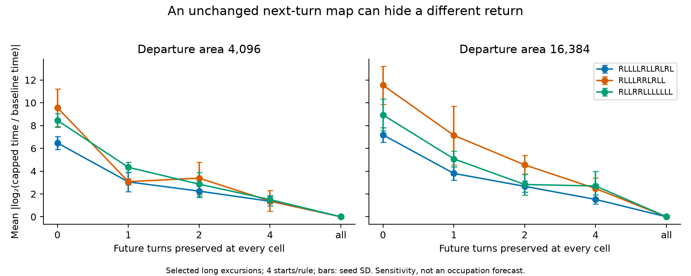

# Can an unchanged turn map hide a different boundary return?

## Registered pilot, 2026-10-23 11:37 UTC

Base: `b942a82854b4d61222301959b9895060d2543d3f`. Registration precedes instrument
construction and all new measurements. This is one excluded development pilot,
not a confirmation study or a test of a growth exponent.

The boundary-return shuffle experiment found that long return times depend on
distant colours, but changed both present turns and future colour clocks. We
separate those two pieces. A cell's colour specifies a cyclic sequence of turns.
Two different colours can prescribe the same next turn and different later turns.

**H-map:** the instantaneous left/right map retains most of the return-time
information under field shuffling. Preserving that map should remove most of the
unrestricted shuffle effect. **H-clock (preferred):** hidden phases carry a large
part of the sensitivity of long returns, even with that map held exactly fixed.
This tests causal sufficiency of the map, not a predictive model of occupation.

At each sampled boundary departure, shuffle colours among interior cells grouped
by `(floor(depth/8), next k turns)`, for k = 0, 1, 2, 4 and n (rule length).
Depth is graph distance to the visited boundary. Boundary colours, territory,
position and heading stay fixed. Each arm preserves the colour histogram in each
depth bin. k=0 is unrestricted within depth bins; k=1 fixes the next turn at
**every cell**; k=n fixes the entire future turn sequence (an exact path sham,
even when nonprimitive rules permit colour changes). Four seeded replicas/arm.
Use independent streams keyed by rule, start, band, departure, k and replica.
Fixed points are retained. This is a large field intervention, not a single-cell
or naturally reachable-state claim.

**Exact prefix control:** until the first trajectory difference, the two ants
have identical visit counts at each cell. Preserving k future turns means a
first difference can occur only on visit k+1 or later to some cell. Check this
on every replay. Arrival colour is deliberately excluded from path equality.

## Cohort, sampling and stopping

Rules are the first three distinct rules of the old return-map pilot:
`RLLLLRLLRLRL`, `RLLLRRLRLL`, `RLLRRLLLLLLL`. Four **new** 5x5-patch seeds
2026102301..2026102304. This does not open the c-law renewal main cohort.
Square board 2048, area bands [4096,4352) and [16384,17408).
Live budget 2^27 steps/start. First 16 completed excursions of length >=128 per
band, with departure times at least 64 steps apart; baseline/replay cap 2^18.
Track **every** departure in each band: completed short, eligible long,
overflowed, quota/gap rejected and unfinished at budget/escape. Keep exact total
completed duration, including overflowed episodes. Stop sampling at quota but
continue counting through the band. No overflowing baseline is silently dropped.
Only episodes whose departure lies in a band enter its counters; an episode
keeps its departure band to completion. Initial fragments are not departures.
If the final horizon cuts an episode, record its observed duration separately.

No extension after results. At most 12 x 2^27 live steps and 384 x 20 x 2^18
replay steps (worst case about 3.6 billion steps); stop with an inconclusive
pilot if gates fail. No new rule or larger sweep in this experiment.

## Frozen outcomes and decision

Primary arm effect: mean absolute log2(T_arm/T_base), with T capped at 2^18.
Average replicas and departures within start/band, then average starts equally
within rule/band. Report signed log ratios, factor-two changes, exact path/return
matches, changed-cell fractions and baseline-read exposure separately. Do not
weight every replica as an independent ant. Report seed SD and a paired
start-level bootstrap (10000 draws, seed 2026102300) within each rule/band.

P1: k=1 retains >=50% of k=0's primary effect in **all six** rule/band cells,
with k=1 absolute effect >=0.5 in each. This supports H-clock at pilot scope.
A ratio <=0.2 in all six supports H-map under this intervention. Otherwise the
mechanistic comparison is unresolved. k=2 and 4 are descriptive dose controls;
no monotonicity is assumed, since partitions change intervention support.

Gates: exact live/cropped replay; independent sparse reference agreement on
synthetic fields; exact k=n path sham; prefix theorem holds; deterministic output
at one and three threads. At least 8 sampled long episodes/start/band; <1% of
baseline departures overflow or remain unfinished; <=1% replay censoring per
arm overall; median changed fraction among distinct baseline-read interior cells
>=0.1 for k=1 in each rule/band. A failed gate prevents an uncensored or general
mechanistic claim; report capped effects, not a rescued threshold. A low count
fraction does not bound missing time: report the overflow duration fraction too.

Controls also include nonprimitive `RLRL` on synthetic fields: k=1 can move
colours but cannot change any future turn. A one-interior-cell territory has
return time exactly one. No exponent/tail fit is used. Rotor/random-walk growth
calibration would not calibrate this paired intervention; reference, analytical
and equivalent-phase controls check its actual contract.

## Pruning-index preflight

Index revision: base above. Commands: `rg --files notes/pruning-index/entries`
and `rg -n -i 'clock|phase|same.turn|return|boundary' notes/pruning-index/entries`.
Text search has no matches. Read the sole signature's membership and exclusions:
`NR-20261022-additive-laws-order-blind` covers additive invariant discrimination,
not phase interventions or return dynamics. Decision RUN; no exclusions.
The negative finite-memory c-law pilot concerns repeated forgetting and births;
this test makes one histogram-preserving intervention at an interior departure
and then restores full memory. No duplicate additive-law mining is needed: its
known order-blind laws do not decide the proposed return-time contrast.

Prior evidence: [return map](../2026-10-21-boundary-return-map/README.md),
[gates and eligibility warning](../2026-10-22-single-cell-gates/NOTEBOOK.md),
[current research priorities](../../notes/ACTIVE.md),
[evidence ledger](../../notes/evidence-ledger.md).

## Reproduction and results

To be appended after implementation and measurement. Predictions above stay fixed.

## Results — 2026-10-23

**Stop: the pilot support gate failed. The mechanistic comparison is unresolved.**
The instrument and analysis were frozen at
`bcfceeb7edd4598fd5c88022dac73e68515e707c` after registration `9d36304`.
All 12 starts reached both bands. Across 9,680 in-band departures, 9,438 were
short, 242 were eligible long returns, and 160 were sampled. There were no
baseline overflows, unfinished episodes, board escapes or censored replays.
However, **17/24 start/band groups had fewer than eight long samples** (some
had one). The prescribed minimum support was not available in these bands.
Do not enlarge the bands or add starts after seeing this result.

[Primary results](results/summary.md), [full JSON](results/analysis.json),
[signed effects, edit fractions and sample counts](results/details.md).
The six k=1/k=0 effect ratios were 0.472, 0.529, 0.322, 0.619, 0.514 and 0.568
(rule order and paired band order as registered). P1 required all six >=0.5;
**P1 failed in two cells**. The H-map criterion also failed. Four passing cells
do not rescue the all-six prediction or the failed support gate.

The narrower result is direct: **all 640 next-turn-preserving replays changed
the path and return tuple**, while all 640 full-word shams matched. The k=1
mean absolute log2 time effects were 3.06–7.14 (seed SD 0.26–2.57 across cells).
Signed means were negative in all cells. No observed time was numerically
truncated by the cap; “capped conditional” describes the registered estimator
and reporting restriction, not an observed censoring problem.



The figure is descriptive. Its five positions are categorical prefix lengths,
not a linear memory scale. The failed support gate applies to the whole plot.

### A checked example, selected after the run

The largest k=1 shortening was **86,030 steps to 6**, for `RLLLRRLRLL`, patch
seed 2026102304, departure time 759018, band 1, sampled departure 1, replica 0.
The paths first split at step 6, on the second read of cell (-54,-65).
That cell starts at colour 5 in the baseline and 4 in the shuffled field:
its future words begin **RL** and **RR**. Both say R on the first read; the
second instruction differs. All cells initially prescribe the same turn in
both fields. This is a large shuffle (10,418 interior colour labels changed),
not a demonstration that this single cell caused the full time change.

An independent sparse Python implementation recreates the patched start,
759,018-step prefix, depth bins, seeded permutation and both complete returns.
It verifies these exact numbers: [witness.json](results/witness.json),
[checker](scripts/check_witness.py). Selection maximises shortening among the
observed k=1 rows; it is an illustrative counterexample, not a typical effect
or a second independent sample.

### Controls, limits and review response

- Four Rust controls passed, with full-path sparse-oracle agreement on
  6 rules x 24 synthetic fields and all five arms, equivalent-phase `RLRL`
  edits, real delayed divergences, and a known one-step return at the cap.
  Three planted-analysis controls passed. Logs: [controls](results/controls.log).
- All 24 pilot CSVs are byte-identical at one and three threads. Source, binary
  and data hashes, commands and environment: [run manifest](results/run.done.json).
  The full CPU `cargo test --release --locked` suite passed with fixed property
  seed 20261019: [test log](results/release-tests.log). No CUDA run is claimed.
- Control wording correction: the live/cropped assertion checks exact **return**
  agreement (time, position, heading and censor flag), not the entire live path.
  Synthetic reference tests compare full paths; the independent real witness
  checks both complete returns. This is less live control coverage than a
  step-by-step check of every sampled path; it is not evidence of a mismatch.
- Bootstrap intervals use four starts/rule. Some start estimates use one episode;
  coverage is not established. The two bands share trajectories. Neither 3,200
  replay rows nor six cells are independent rule replicates.
- The arm ratio is **not a fraction of causal information or explained variance**.
  k=0 and k=1 use different permutation classes and edit different patterns.
  k=1 preserves each initial turn but disrupts hidden phases and their spatial
  organisation together. Changed-label fractions are not effective changed-turn
  exposure. Exact path divergence establishes that a changed turn was reached.
- Conditioning on long unedited returns favours shorter shuffled returns. These
  are causal comparisons at selected states, not estimates for ordinary departures
  or the interior time budget. The perturbed fields need not be naturally reachable.
- The delayed-turn argument and the distinction between current turns and future
  clocks already appear in the [c-law renewal proposal](../2026-10-20-c-law-renewal/README.md#next-discrimination-one-phase-edit-rather-than-sustained-forgetting).
  The contribution here is the measured whole-field, depth-bin-histogram-preserving
  intervention and its eligibility audit, not a new prefix theorem. The separate
  single-cell proposal, birth-cost question and unopened main cohort are untouched.

An independent source audit found no clear simulation defect and raised the
interpretation/control limits above. No new confirmation run followed that audit.

## Reproduce

From the repository root, with the locked environment (`uv sync --frozen`):

```sh
uv run --frozen experiments/2026-10-23-hidden-phase-return/scripts/run.py
uv run --frozen experiments/2026-10-23-hidden-phase-return/scripts/test_analysis.py
uv run --frozen experiments/2026-10-23-hidden-phase-return/scripts/analyze.py
uv run --frozen experiments/2026-10-23-hidden-phase-return/scripts/report.py
uv run --frozen experiments/2026-10-23-hidden-phase-return/scripts/check_witness.py
uv run --frozen experiments/2026-10-23-hidden-phase-return/scripts/build_notebook.py
PROPTEST_RNG_SEED=20261019 cargo test --release --locked
```

The runner verifies existing result hashes and skips a completed run. To regenerate
CSV bytes without overwriting evidence, build the example and write both thread
runs to ignored scratch directories, then compare each file with `results/`:

```sh
CARGO_TARGET_DIR=experiments/2026-10-23-hidden-phase-return/scratch/fresh-build cargo build --release --locked --example hidden_phase_return
experiments/2026-10-23-hidden-phase-return/scratch/fresh-build/release/examples/hidden_phase_return experiments/2026-10-23-hidden-phase-return/scratch/reproduced 3
```

Use a previously absent build directory for a new published run. The binary uses
fixed rules, seeds, board, bands and cap; the optional last argument changes the
live budget for instrument diagnostics only. It does not change the registered run.
The analysis and report read only committed results. The witness checker is a
post hoc independent verification; it does not change the frozen primary analysis.

## Pruning outcome and next question

No dead-end signature: the support gate failed, so this cannot justify pruning
H-clock, H-map, any rule family or a transport mechanism. The exact next-turn
map alone is insufficient on the tested edited fields, a narrower fact than a
rejected general mechanism. Keep that constraint when designing a predictor.
A future study must register sampling that gives enough long episodes, retain
full eligibility accounting, and distinguish delayed single-cell effects from
collective phase organisation. It must predict separate trajectories against
persistence before claiming to explain occupation. No such study is run here.

## Review follow-up — 2026-10-25

Appended after merge; the registration and results above are unchanged.
Review of PR #8 made three points that apply to this record.

- **Status of P1.** The support gate failed (17/24 groups under eight long
  episodes), so under the frozen decision rule P1 was not testable. The six
  ratios and the two cells below 0.5 are descriptive, not a refutation.
  Summaries elsewhere (blog, homepage, atlas, notes) were reworded to match.
- **The 640/640 result.** After about 10^4 relabelled cells, a changed path
  needs only one second read of one cell, so this is near-certain and checks the
  instrument. The informative evidence is the independently reproduced witness,
  which shows the next-turn map alone does not fix paths on these edited fields.
- **Sample size.** 160 sampled episodes, four starts per rule, some start-level
  estimates from a single episode; bootstrap coverage at this size is not established.
