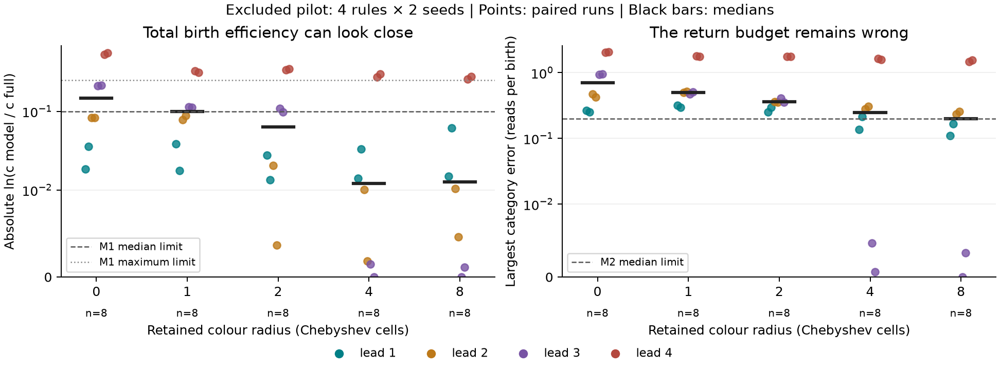

# Can a local renewal model explain the cost of a new cell?

**Current status (2026-10-20):** calibrated recorder and boundary clock work.
The rich lookup lacks transfer support. A finite colour-memory model also
fails its registered cost/budget tests: preserving nearby short-loop phases
while randomizing forgotten long-return phases is insufficient in this pilot.
Read/write-bit closures also fail native boundary-return and birth-wait tests;
physical-time stretching alone cannot rescue them. Main outcomes remain unopened;
the c-law coefficients remain unexplained.

Scaffold created 2026-10-20 (+13:00), base revision
`adf66774570469da30b10ffc1ceab911670a9d09`.
**Scaffold status at creation: prospective design, not a frozen preregistration. No simulations or
scientific fits have been run for this experiment.** Preparing rules is design
generation, not evidence. Freeze the instrument, model and pilot decisions in a
dated addendum before any main-cohort measurement. Preserve this draft.

## Question and motivation

Why does the number of boundary reads per birth approximately follow
`1/c = a + b m`, where `m` is the opening same-letter run? Can a small local
state predict both this cost and corrections from letters 5–8?

The [parent experiment](../../archive/2026-10-c-law-mechanism/README.md) establishes a
controlled flat-band setting and rejects the simple flat colour-profile and
transition-kernel explanations. Its Stage 2/3 results motivate locality, but
do not derive the intercept or slope. Its Stage 4 reconciliation rules out
treating the conditional lead–kappa association as evidence of a mechanism.
See [the open questions](../../../notes/open-questions-hypotheses.md) and
[calibration](../../../notes/calibration.md). This experiment targets **c**, not
kappa or a derivation of the growth exponent.

## Hypothesis and competing explanations

**H-local (untested):** the sequence of boundary events can be approximated
by a finite-state Markov reward process. Short loops, birth chains and
excursions away from a local patch determine the boundary-read cost per birth.
Increasing the lead changes their transition probabilities; later letters
change survival after a short loop. Transition rules learned on training
families should transfer to other rule families and interior seeds.

**H-history:** the same local state has different futures depending on
long-lived field structure or previous returns. A model can reproduce pooled
c while missing the return budget, paired-rule effects or history dependence.
Births are candidate renewal points, not assumed independent regenerations.

## Definitions and accounting

- A boundary read starts on a visited cell with at least one unvisited
  four-neighbour, including inner-hole rims, exactly as `probe`/`edge_trace`.
- A birth is a step onto a never-visited cell. The first read there occurs
  on the following step. Attribute births to the source read.
- Measure `c = births / boundary_reads` over `(T/2, T]`. Report zero denominators.
- Index all boundary reads in time order, including reads that do not birth.
  For each event record source state, whether it births, and the next event
  state. Interior steps between events have zero boundary reward but their
  elapsed duration and return category are retained.
- For an ergodic closed embedded chain with stationary weights `pi` and
  expected birth reward `p(s)`, predict `c_hat = sum_s pi(s) p(s)`. This is a
  *prediction* only if transitions/rewards are learned without target-run
  counts. Computing pi from the target's empirical event frequencies is an
  accounting check and must never be scored as predictive success.
- Independently partition each boundary read into previous source-cell read
  lag `first`, `4`, `other <=16`, or `>16`. Lag is since any previous read,
  not merely the previous boundary read. Report category counts per birth;
  they sum exactly to `1/c`. Chains are maximal consecutive births.
- Keep initial/final partial chains and transitions explicit. Unseen next
  events at the end are right-censored, not long-return observations.
  Cell-lifetime `N_b` is secondary: window entrants and censored cells can
  invalidate an uncorrected Little's-law equality.

## Proposed state hierarchy (must be frozen before main measurement)

Work in the incoming-heading frame, reflecting L-first rules to R-first.
Candidate S0: source colour (0..13), its next eight rule turns relative to
the initial turn (cyclic), and the four-neighbour visited mask. Candidate S1:
S0 plus the visited mask and current turn signs at visited sites in the 3x3
patch. Unvisited cells are explicitly marked, not treated as visited colour 0.
Candidate history challenge S2: S1 plus the previous-read lag category and
previous birth-chain length (0,1,2,3,>=4).

S0/S1 are competing local models; S2 tests hidden history, not an excuse to
silently enlarge a failed S1. States, orientation, transition pooling,
smoothing/backoff, treatment of unseen states, stationary-solver choice and
non-ergodic classes remain **implementation gates**. A raw rule identifier
must not enter a state. No fit may use target-rule c, target event frequencies
or target area. Publish unseen-state mass and solver failures.

Sparse states may make this hierarchy infeasible. Pilot support decides
whether a prospective revised state is necessary; preserve the rejected
candidate and register the revision before main measurements.

## Cohort and paired challenge

`scripts/prepare.py` deterministically prepares the design in `results/design/`.
Seed 2026102001; 14-letter primitive R-first bases; m=1,2,3,4, each with
8 training and 4 validation families (48 bases). Four additional pilot
families, one per lead, are excluded from scoring. Every family contains:

1. Base rule.
2. An opposite-letter swap within zero-based indices 4..7 (letters 5–8).
3. An opposite-letter swap within indices 10..13 (letters 11–14), a late-letter
   comparator, **not assumed inert**.

Swaps preserve length, R-fraction and lead. Accept only families with three
primitive rules and no mirror/rotation-equivalent rules across or within
families. Exclude necklaces in the parent's sample, band and validation lists;
this does not guarantee absence from every historical dataset. Splits are by
family: no sibling crosses training, validation or pilot boundaries. No
stationarity or blob screening is used to select the design.

Band layout proposed: torus 256x4096, rows 0..2047 initially fresh, remainder
visited with uniform i.i.d. colours using the parent's `mix64` coordinate hash.
Start at (128,2048), heading north. Main interior seeds 2026102011..14, paired
across siblings; pilot seeds 2026102021..22. Later implementation must document
the exact hash, coordinate convention and binary digest.

Pilot horizon ladder: T=2^22 through 2^26. Choose one common T, the smallest
for which >=3 of 4 pilot families have all arms/seeds consume 10–80% of the
initial fresh band and yield >=5000 window births. If none qualifies, stop
and register a geometry/budget revision. Do not pick a different horizon for
each main rule. Main failures are retained in status tables, never replaced.

## Draft predictions and decision rules

Thresholds below are prospective design choices, not results or pilot-tuned
claims. Freeze or explicitly revise them after instrument calibration and
pilot support checks, before opening main outcomes.

| ID | Proposed test | Proposed criterion |
|---|---|---|
| G0 | Instrument equality vs `edge_trace` and independent sparse path reference | Exact births, boundary reads, chain counts and full lag categories on small seeded cases, including censoring and band prefill; same bytes with 1 and 6 threads |
| G1 | Synthetic finite-state reward chains with known stationary answers | Absolute c error <=0.01 at 10^6 events, 16 fixed seeds; report signed bias and between-seed sd; controlled nonlocal process exposes inadequate local state |
| G2 | Walker controls | Rotor and random-walk accounting agrees with unchanged tracer; larger rotor blank run c in [0.47,0.52], random walk in [0.40,0.48], 8 seeds each, configurations from parent calibration; these calibrate instruments, not ant models |
| G3 | Cohort/support | >=12 of 16 validation families have all arms and >=3/4 seeds usable; unseen state mass <=5% on each scored run and solver well-defined; otherwise primary verdict UNINFORMATIVE |
| P1 | S1 predicts validation c with training-only parameters | R² >=0.90 and median relative error <=5%, using per-rule means; beat training-fitted lead law and K3, with family-bootstrap interval for each MSE improvement above zero |
| P2 | Predict the accounting decomposition | Per-category median absolute error <=0.10 boundary reads/birth for first, lag-4, other-short and long reads; test all four, not just their sum |
| P3 | Predict paired early-swap effects | On validation family deltas of ln c, R² >=0.50 and sign accuracy >=75% for informative pairs; informative = paired |mean delta| >2 paired-seed SE, >=8 informative families required |
| P4 | Test locality against history | Adding S2 improves held-out MSE by <10%; >=20% improvement with bootstrap lower bound >0 rejects the proposed S1 closure; intermediate outcomes unresolved |

Compute validation R² with validation-mean denominator; constant/near-zero
delta variance makes P3 uninformative, not a pass. Fit lead baseline `1/c=a+bm`
and the parent's K3 on training data only. Fit all smoothing/hyperparameters
by family-wise inner CV inside training. Validation is opened once after
freezing the pipeline. No target-run transition estimation.

Uncertainty: 2000 family bootstrap draws, seed 2026102002, all siblings kept
together. Report between-interior-seed sd separately; reads are not independent
replicates. Publish unfiltered status and retention by arm and lead. Report
each prediction's verdict independently. Mechanistic support requires P1–P3
and no P4 rejection; it would support this closure on this geometry, not prove
an exact universal law. A good c fit with failed decomposition is a failure.

## Implementation handoff and gates

1. Commit this scaffold and design. Append the start entry to `NOTEBOOK.md`.
2. Implement an experiment-prefixed Rust example and a clear independent
   reference. Existing `src/edge_trace.rs` is an aggregate oracle, **not an
   ordered-event instrument**. Its driver truncates lag output: do not infer
   a complete long-return budget from that JSON. Add path/oracle property
   tests, deterministic reduction and explicit censoring.
3. Implement synthetic estimator calibration, then excluded pilot. Freeze
   model details, horizon, resource budget and runnable commands in README.
   No scientific inference before G0–G2. Main G3 is checked before scoring.
4. Run resumable per-(family,arm,seed) chunks. Keep bulk ordered events under
   this experiment's ignored `dumps/`; commit small transition/reward summaries
   sufficient to refit without dumps. `.done` only after output validation;
   verify input and binary hashes before reuse. Interrupted chunks restart.
5. Analyse once, execute the shareable notebook using only committed results,
   append verdicts here and in the lab notebook; update open questions and
   blog homepage when there is evidence or a changed research priority.

Use CPU: the new instrument is not GPU-ported. No concurrency with heavy jobs
or GPU timing. Estimate runtime in the pilot before launching main work; long
runs go in the background with a log under this experiment's `results/`.
For published runs build into a fresh target directory, check build exit
status and record binary SHA-256 to avoid the `/mnt/f` stale-build trap.

## Available commands (WSL, repository root)

Every invocation must set the WSL environment:

```bash
export UV_PROJECT_ENVIRONMENT=$HOME/.venvs/turmite UV_LINK_MODE=copy
uv run --frozen experiments/active/2026-10-c-law-renewal/scripts/prepare.py
uv run --frozen experiments/active/2026-10-c-law-renewal/scripts/prepare.py --check
cargo test --release
```

Only the design preparer exists. There is deliberately no simulation or
scientific analysis command yet; steps 2–3 above are required first.
`prepare.py` refuses to overwrite different design files. Its provenance
records exact command, base revision, source/config/script hashes and seeds.
No dependencies are added. Notebook execution once Jupyter is available:

```bash
uv run --frozen --with jupyter --with nbconvert --with ipykernel jupyter nbconvert --to notebook --execute --inplace experiments/active/2026-10-c-law-renewal/notebook.ipynb
```

## Results

None. The generated manifest contains planned rules and assignments only.

### Scaffold verification — 2026-10-20 00:36 (+13:00)

Design generated and byte-checked: 4 pilot + 32 training + 16 validation
families, three rules each. The shareable notebook executed in a fresh kernel
against committed design inputs; `cargo test --release` passed (existing
warnings). These checks do not evaluate G0–G3 or P1–P4. No Rust instrumentation
or scientific estimator was implemented. See `NOTEBOOK.md` for commands,
the mount-mode correction and concurrent commit provenance.

## Ordered-event instrument registration — 2026-10-20 00:40 (+13:00)

Before new ant measurements: `src/edge_renewal.rs` implements source states
exactly as the draft hierarchy, emitting every boundary read in `(T/2,T]`.
Patch order is forward, forward-right, right, back-right, back, back-left,
left, forward-left; each two-bit digit is fresh=0, visited with rule[0]'s
turn=1, visited with the opposite turn=2. Four-neighbour bits are forward,
right, back, left. Frame is incoming heading, reflected for L-first rules.
`next8` bit j marks equality of rule[(colour+j) mod n] to rule[0]. The full
state also contains the source colour, previous-read lag category and count
of consecutive preceding births (capped at 4). Lag tracking starts at step 1,
including the warmup, and tracks all reads. Window chains are clipped as
in `edge_trace`, with left/right censoring flags kept separately.

The callback is after the move but all state features are captured before
the move. No target outcome or area is encoded. Consecutive emitted events
are linked only within the measurement window; the last is right-censored,
never linked back to the first. Counts output retains state reads/births and
ordered transition counts plus event-gap category/duration sum. Events mode
retains every emitted timestamp. Summary mode avoids count-map allocation.
Tests compare against an independent sparse position oracle and the full
unchanged aggregate tracer, including rotor and random walk.

`examples/c_law_renewal_trace.rs` is a single-run driver. Interface:

```text
band RULE SEED LOG2 W H FRESH_ROWS [counts|events|summary]
blank RULE|rotor:SEED|rw:SEED LOG2 SIZE [counts|events|summary]
```

CSV goes to stdout; a summary JSON goes to stderr. In summary mode the JSON
also goes to stdout. Band initialization matches the parent's hash exactly:
`mix64(mix64(seed) XOR ((x as u64)<<32 | y as u64)) mod rule_length`.
This registration covers the instrument; main models remain unfrozen.

### Calibration and excluded-pilot freeze — 2026-10-20 00:42:53 (+13:00)

Frozen before running these scripts. `scripts/calibrate.py` tests the actual
stationary solver on a two-state chain P=[[.9,.1],[.2,.8]], rewards (.1,.7),
known c=.3, 10^6 events per seed 2026102031..46. G1's <=.01 absolute-error
criterion applies. A periodic chain must converge under lazy iteration;
a reducible chain is rejected pending an explicitly registered class rule.
Negative control: a hidden alternating 256-event regime, birth probabilities
.05/.95, seed 2026102047, 10^6 events. Its pooled c is near .5 even when
P(next birth | birth) and P(next birth | no birth) differ by >.5. This exposes
why a correct total cannot validate history-free closure. G1 calibration
here covers the stationary/reward solver, **not yet the ant state/backoff
model**, which still needs its own synthetic validation after selection.

`scripts/run_pilot.py` builds in a fresh WSL-home target directory, records
binary/source hashes, then runs sequential resumable controls and excluded
pilot only. No heavy job or GPU timing may overlap measurement. Control
seeds 2026102051..58: rotor blank 2^24, 4096 square; random walk blank 2^20,
4096 square (the parent's non-escaping configurations). Mean c must meet G2;
report between-seed sd and escapes, never silently exclude escaped runs.
Small band count output must match byte-for-byte at thread settings 1 and 6.

Pilot follows the original ladder 2^22..2^26 and exact family gate above.
No automatic extension is allowed after failure. Counts at a selected horizon
are recorded only for excluded pilot rules; bulk goes to ignored `dumps/`.
Before main freeze, measure support of S0, S1 and S2 by leave-one-pilot-family
out count summaries, comparing both exact features and rule-independent
coarsenings. This is a feasibility diagnostic, not a validation score. If the
8-turn word isolates rule families, reject this state design rather than
passing a transition model off as a learned lookup of rule identity.

Commands (WSL, usual UV exports; no main-run command exists):

```bash
uv run --frozen experiments/active/2026-10-c-law-renewal/scripts/calibrate.py
uv run --frozen experiments/active/2026-10-c-law-renewal/scripts/run_pilot.py --stage build
uv run --frozen experiments/active/2026-10-c-law-renewal/scripts/run_pilot.py --stage controls
uv run --frozen experiments/active/2026-10-c-law-renewal/scripts/run_pilot.py --stage pilot
```

Run long stages in the background, logging under `results/pilot_v1/`.
Every chunk has its exact argv, build/driver hashes, duration, complete
summary and SHA-256 `.done` marker. This is an instrument/pilot stage and
does not establish P1–P4.

### Exact immediate reward; remaining modelling task

The source state determines the immediate birth outcome exactly. In the
canonical frame, let d=1 (right) when `next8 & 1` is set, otherwise d=3
(left). Then `born = ((visited4 >> d) & 1) == 0`. Consequently a fitted
birth-probability regressor is unnecessary for ant states. The independent
path comparison also checks this identity for each emitted ant event.
The reward-estimator calibration remains a solver control, not evidence
for a learned ant birth mechanism.

What needs explaining is the occupancy of these local states, including
how loops and long returns generate their distribution. A cross-rule
transition model must additionally enforce target-rule-compatible successor
features; a pooled transition matrix can otherwise jump into an eight-turn
word that the target rule cannot produce. This is an explicit main-model
gate, not permission to estimate successor weights on the target trajectory.
Neither the immediate predicate nor the accounting identity derives a or b.

## Pilot outcome and diagnostic addendum — 2026-10-20 00:49 (+13:00)

The original ladder terminated normally with **no usable common horizon**:
0/4 complete families pass at any k=22..26. At k=26 only 2/24 runs pass;
6 miss the >=5000 window-birth requirement and 22 miss the 10–80% consumed
band requirement. The main cohort remains unrun. Source:
`results/pilot_diagnostics.{json,csv}`, made by `scripts/pilot_diagnose.py`.
G0 oracle checks and G2 walker controls pass; the synthetic stationary solver
passes its narrow calibration, but the full ant estimator is not calibrated.
This pilot failure gives no verdict on P1–P4 or local closure.

Before collecting any state counts from this cohort, register a **diagnostic
repeat only** of all 24 excluded pilot runs at k=26, same geometry, seeds and
hashed binary. This changes neither geometry nor horizon and cannot rescue
the failed gate. Budget <=24*2^26 extra steps; no other heavy jobs may run.
Require summaries to match original runs exactly. Save state/transition
counts under ignored `dumps/pilot_support/`, hashes and compact audits under
`results/`; every chunk is validated before its `.done` marker.

Prospective feasibility prediction: S1's full source-colour/eight-turn-word
state will have >5% unseen read mass in at least 12/24 runs when trained on
the other three pilot families. The same test on S0, S2 and C0/C1/C2/C4/C8
coarsenings (word prefix lengths 0,1,2,4,8 plus patch, omitting source colour)
is descriptive. No c model or target transition weights will be fitted.
Passing support would only permit further model design; it would not repair
the horizon failure, demonstrate transfer or establish a mechanism.

Command, usual WSL UV exports: `uv run --frozen
experiments/active/2026-10-c-law-renewal/scripts/support_probe.py`.

To queue this diagnostic behind existing heavy jobs, use `uv run --frozen
experiments/active/2026-10-c-law-renewal/scripts/launch_support.py`. The worker
records its live PID and waits on actual `/proc` release/cargo command lines;
read `results/pilot_support/session.log` and local `.exit` status before
attempting a restart. No scientific inference follows from waiting or from
completion of a process alone; inspect its validated outputs.

## Excluded state-support audit — 2026-10-20 00:59:52 (+13:00)

Completed with exit status 0 after other observed heavy jobs finished. All
24 counts-mode summaries match their original k=26 summaries exactly.
State rewards obey the exact immediate-birth predicate; outgoing edge counts
plus one terminal event equal state counts, and incoming counts leave exactly
one window-entry event. These checks validate ordered summary serialization.

`scripts/support_probe.py` -> `results/support_report.json`; all chunk recipes,
hashes and `.done` markers in `results/pilot_support/`. Compressed bulk count
tables stay in ignored `dumps/pilot_support/` and can be regenerated with the
recorded binary/argv. The notebook reads only committed compact summaries.

| Representation | Median unseen read mass | Maximum | Runs >5% |
|---|---:|---:|---:|
| S0: source colour + eight turns + neighbour mask | 1.000 | 1.000 | 24/24 |
| S1: S0 + patch | 1.000 | 1.000 | 24/24 |
| S2: S1 + history | 1.000 | 1.000 | 24/24 |
| C0: patch alone | 0.00888 | 0.06894 | 4/24 |
| C1: current turn + patch | 0.02264 | 0.07459 | 7/24 |
| C2: two turns + patch | 0.04275 | 0.30089 | 12/24 |
| C4: four turns + patch | 0.36132 | 0.54622 | 24/24 |
| C8: eight turns + patch | 0.94443 | 1.00000 | 24/24 |

Training support here is the union of all other three pilot families, all
their arms and both seeds; an unseen state has zero examples, not merely
few examples. S0/S1/S2 have **100%** unseen mass in every individual run.
The prospective feasibility prediction held. This is not a main-cohort G3
score: the planned training cohort is larger and no validation outcomes were
opened. It shows the pilot cannot train/test a literal cross-family lookup
over the proposed rich states. C8's loss of support without source colour
also shows that the eight-turn word itself isolates contexts. Removing the
word and colour improves support but does not validate a replacement model.

**Decision:** do not fit the original rich-state lookup or interpret its
unseen-state fallback as mechanistic success. Preserve the failed horizon
gate and original predictions. A prospective replacement should apply the
target rule's phase updates exactly and learn only missing neighbourhood or
return information. A pool of observed successors must not silently change
the target rule. This compositional closure is a proposal, not an implemented
or registered main model. Its synthetic calibration, sampling revision,
mechanism tests and held-out evaluation remain required. P1–P4 are untested.

## Finite colour-memory closure pilot — 2026-10-20 01:06:34 (+13:00)

Registered before implementing or measuring the new model. This is an
excluded-pilot intervention, not a replacement score for original P1–P4.
The previous turn made progress by rejecting an unsupported representation;
all original jobs are terminal. The main cohort stays unopened.

**H-memory:** exact phase updates in a small moving patch are sufficient to
reproduce the ant's boundary-read cost. Long-range phase memory is dispensable
for c even if it changes growth or boundary occupation. This is stronger than
the known immediate-birth identity and is falsified by a changed return budget.

The model generates its own complete path and visited set. Keep colours for
read cells inside a Chebyshev-radius r square centred on the walker, evicting
the outgoing strip after every step. Inside the patch, turn and increment by
the target rule exactly. At a previously read cell absent from the cache,
replace its phase by a uniform draw from 0..n-1 before reading, then advance
normally. First reads retain their original blank/background phase. No target
trajectory, target state frequency, census c, or learned rule identifier is
used. The persistent visited geometry is produced by this model, not supplied
by the full ant. Thus it tests local **colour** memory, not whether global
geometry is dispensable. An r=4 reset-to-zero arm challenges sensitivity to
the chosen external-phase distribution. The no-eviction arm is the exact ant.

Random draws: the existing SplitMix64 stream, one draw per forgotten re-read,
uniform modulo n. Interior seeds 2026102021/22 use reset seeds 2026102061/62,
respectively; all arms have these fixed seeds. Rule phase remains exact
between explicit resets. Resets occur before source statistics are recorded;
the instrument needs a tested pre-read hook to avoid labelling the old phase.
Neighbour phase labels in the old rich lookup are not model inputs or scored
predictions. A reset changes colour, never whether a cell has been visited.

### Frozen pilot recipe and predictions

- Four **base** rules of the existing excluded pilot, both original seeds;
  no choice by c or survival, no replacement. T=2^26, original 256x4096 torus,
  2048 fresh rows, same start and hash. Window `(2^25,2^26]`.
- Arms: full ant; uniform-reset r=0,1,2,4,8; zero-reset r=4. At most
  56*2^26 steps. Fresh build, binary/source hashes, background log, resumable
  per-(rule,seed,arm) chunks. No overlapping heavy job or GPU timing.
- **M0 oracle gate:** ring-cache walker matches an independent HashMap
  implementation step for step (phase before/after reset, headings, positions,
  eviction and reset counts) on seeded blank/band cases including wrapping.
  Full arm matches `AntWalker`; a cache containing the entire path causes
  no resets; a radius >=1 preserves the all-same-turn four-step loop.
  The pre-read instrument matches existing no-hook control totals exactly.
- **M1 pilot sufficiency candidate:** r=4 and r=8 uniform arms each have median
  absolute paired `ln(c_model/c_full)` <=0.10 and maximum <=0.25 on eligible
  pairs. This criterion is not a proof of transfer and cannot finish the goal.
- **M2 accounting challenge:** at r=4 and r=8, median over eligible pairs of
  the maximum absolute error across `first/lag4/other-short/long reads per
  birth` <=0.20. Matching c with a wrong decomposition fails the candidate.
- **M3 phase-prior challenge:** r=4 zero and uniform arms have median absolute
  paired ln c difference <=0.10. Failure says the external-phase closure
  matters, not that long-range memory is necessarily required.

Sampling revision for this pilot only: eligibility requires >=1000 boundary
reads and >=500 births in both compared windows, no escape and <80% total
fresh-band consumption at the end. Do not require 10% consumption: the earlier
pilot showed this geometric-size gate suppresses many otherwise measurable
boundary samples. This explicitly revises the pilot sampling criterion; it
does not retrospectively pass the failed original gate. Require >=6/8 eligible
pairs for each primary comparison, otherwise UNINFORMATIVE. Publish all runs,
eligibility reasons, per-seed deltas and within-rule two-seed spread. These
pilot comparisons are descriptive feasibility tests; no tiny-n significance
claim or main-cohort validation. r=0/1/2 profiles and reset exposure are
descriptive, with no monotonicity assumed. All arms are fixed before data.

If no finite radius meets M1+M2, stop this closure and diagnose which budget
component changes. If it does, freeze a fresh held-out test and paired-mutant
challenge before opening the main cohort. Deriving/predicting the c-law
coefficients and later-letter corrections remains part of the research goal.

### Boundary-clock amendment — 2026-10-20 01:09:00 (+13:00), before implementation/run

Prospective design correction, not a response to new model outcomes. The
fixed-step recipe immediately above is superseded for the finite-memory
pilot; retain it as the original proposal. Forgetting bulk phases may change
growth enough to exhaust the finite band before a step-time window opens.
That would confound a local boundary-cost comparison with growth rate again.

Use an **embedded boundary-event clock**: exclude the first 2048 boundary
reads, measure the next 8192, cap the entire run at 2^28 physical steps.
The measurement includes all physical steps between its first/last boundary
events; lag is still physical time since any previous read. Record physical
start/end time, completeness, clipped chains and partial windows explicitly.
No choice of clock or threshold per rule. Stop a completed run on its last
measured boundary read. At most 10240 births can occur before this stop, so
fresh-band consumption cannot exceed 10240/524288 (<2%); this analytically
prevents the depletion confound without dropping fast-growing model arms.
The original failed fixed-time pilot remains failed.

Eligibility: the full-ant reference must complete its 8192-read window with
>=500 births; each comparison arm must complete the same read count without
escape. >=6/8 eligible pairs are needed for M1/M2, otherwise UNINFORMATIVE.
A complete model window with zero/few births is **not excluded**: it is an
outcome (zero c gives an infinite log-cost discrepancy and fails sufficiency).
Cap failures remain visible, with read progress and all partial summaries.
All original M1/M2/M3 thresholds, arms, excluded base rules, seeds and policy
choices are unchanged. Worst-case bound is now 56*2^28 steps; actual work
stops at the event budget. Profile feasibility/runtime on these fixed cases;
do not enlarge the cap or replace slow rules without another registration.

This changes the observation window, so add calibration before any pilot
claim: independent offline prefix/window selection must agree exactly with
the new clock (including physical lags and chain censoring). Rotor and random
walk controls: 8 seeds 2026102051..58, blank 4096 board, the same boundary clock
and cap; means within G2's original ranges, report sd and deviations from the
parent controls. The M0 walker oracle and no-reset identity remain mandatory.

### Exact spatial-return bound — 2026-10-20 01:21:42 (+13:00)

This is a geometric deduction, not a simulation result. Between two reads
of the same cell on the square lattice, axes alternate. A closed path of
length k has k/2 horizontal moves, half in either sign, and the same vertically.
Therefore k is divisible by 4 and its maximum coordinate excursion from the
source is at most k/4. Evicting that source from a Chebyshev-radius r cache
before its next read requires an excursion >=r+1, hence **k>=4(r+1)**.
For the large torus this also holds for winding returns: each circumference
exceeds 2r+1, so an alternating-axis winding route takes at least 4(r+1) steps.

Consequences: radius 1 always preserves lag-4 source phases; radius 4 preserves
every source phase returned to within 16 physical steps; radius 8 within 32.
The r=4/r=8 interventions directly change only the registered long-read class,
although a reset can indirectly change all subsequent trajectories and budgets.
This sharpens the mechanism test: preservation of immediate short loops is
guaranteed, while the importance of longer-return phase memory is empirical.
It does not predict that c or the lag-4 *frequency* stays unchanged.

M0 additionally checks this bound on every reset in the sparse oracle, and
exhausts all 16-step turn words and their closed prefixes. The driver reports
reset exposure by read-lag class; r>=4 must have no resets in first/4/<=16
classes. Exact turn-bound logic is not a fitted statistic. These checks and
exposure reports are registered before new model measurements.

### Implementation and reproducible commands

`src/local_memory.rs` has a ring cache checked against independent HashMap
eviction; `edge_renewal::trace_clock` applies resets before read labels and
implements the embedded window. Existing `trace` remains the exact old
octave interface. Source-phase exposure and per-colour read/birth counts are
recorded, with reset counts by lag class. A match without meaningful reset
exposure is only a weak locality challenge and cannot establish sufficiency.

All code, seeds, clock, policies and analysis criteria are frozen in the
implementation commit and `memory_design.json` before data collection. Commands
from WSL repository root with usual UV exports:

```bash
uv run --frozen experiments/active/2026-10-c-law-renewal/scripts/run_memory.py --stage build
uv run --frozen experiments/active/2026-10-c-law-renewal/scripts/run_memory.py --stage controls
uv run --frozen experiments/active/2026-10-c-law-renewal/scripts/run_memory.py --stage pilot
uv run --frozen experiments/active/2026-10-c-law-renewal/scripts/analyse_memory.py
```

For a detached sequential execution of these stages, after waiting on verified
heavy jobs: `uv run --frozen
experiments/active/2026-10-c-law-renewal/scripts/launch_memory.py`. Read the actual
worker PID/terminal status before retrying. Results and background log are in
`results/memory_v1/`. Fresh build directory, binary/source hashes and oracle
test exit status are captured. Each case has a recipe-keyed `.done` marker;
parallelism is across independent seeded cases (default 2 workers), with
identical scientific JSON regardless of scheduling. Timing is printed only to
the log; there is no speed claim. Old data are never overwritten.

## Finite-memory outcome — 2026-10-20 01:34:30 (+13:00)

Code/registration revision `c826721c2591201c45efeca9900abac5f8f4f841`.
Fresh-build oracle tests and boundary-clock walker controls pass. Rotor c
0.500748 (between-seed sd 0.003133, 8 seeds); rw 0.462433 (sd 0.006132, 8).
Their differences from the earlier fixed-time means are +0.003244/+0.015830;
this early boundary clock is not an unbiased substitute for a late-time
walker comparison. Sources: `results/memory_v1/controls.json`, `build.json`.

All 56 pilot cases are recorded with validated markers. Both primary uniform
arms have 8/8 eligible pairs. **M1 and M2 fail for both radii as registered.**

| Arm | Median absolute ln(c model/full) | Maximum | Median largest budget error | M1 / M2 |
|---|---:|---:|---:|---|
| Uniform r=4 | 0.012054 | 0.298926 | 0.248662 | FAILED / FAILED |
| Uniform r=8 | 0.012623 | 0.276185 | 0.200881 | FAILED / FAILED |

M2's r=8 miss is narrow (criterion <=0.20); do not round it into a pass.
Six of eight zero-reset r=4 runs reach the 2^28-step cap without opening
the measurement window. Only 2/8 policy comparisons are defined, so
**M3 is UNINFORMATIVE**, not support for prior independence. Those two are
the lead-3 rule, whose boundary reset exposure is zero at r>=4; matching that
rule is a weak locality challenge. No capped run was replaced or assigned c=0.

The lead-4 rule `RRRRLLRRLLLLRR` accounts for the large cost discrepancy:
r=4 predicts c 31–35% higher than full, in both seeds (equivalently about
24–26% fewer boundary reads per birth). r=8 remains 30–32% high. The other
rules' closer totals do not establish the proposed closure.

Exploratory decomposition (`scripts/diagnose_memory.py`, after the registered
failures): for that lead-4 rule, r=4 reduces long-return reads per birth by
1.63/1.59, increases lag-4 reads by 0.51/0.47, and changes total cost by
-0.95/-1.05. For the lead-2 rule, increased lag-4 and decreased long-return
costs nearly cancel: a good total c hides a wrong return budget. r>=4 resets
only the long class directly, so these changed short-loop frequencies are
indirect effects of the altered return history, not direct short-phase erasure.
The full-ant boundary-clock versus old k=26 c audit has maximum absolute
ln ratio 0.0406 across these eight seeds. That is a limited age check on this
pilot, not a fresh confirmation of stationarity or a universal bias bound.



Points are eight paired runs from four rules, not eight independent rules;
black bars are medians, no confidence interval is claimed. Figure recipe:
`uv run --frozen experiments/active/2026-10-c-law-renewal/scripts/plot_memory.py`
(inspect the existing generated image before `--replace`). JSON inputs only;
no fitted parameters. Numerical results: `results/memory_report.json`;
signed budgets and clock audit: `results/memory_diagnostics.json`. The plot
omits zero-policy arms because their clock completion is the separate M3 issue.

**Decision:** stop this uniform-exterior finite-memory candidate as promised;
do not extend the radius or open the main cohort to find a passing case.
Local short-loop phase clocks alone, with uniform forgotten phases, do not
predict the full read cost/budget. This does not rule out a better local
closure or prove a universal need for a particular radius. No c-law
coefficients or later-letter mechanism have been derived.

Next candidate (proposal only): on a forgotten re-read, scramble the phase
within its **old current-turn class**, rather than across all phases. This
retains one exterior bit per cell while erasing the rest of its phase clock.
Compare with retaining the next two turns. If one-bit preservation restores
the long-return budget while phase scrambling remains substantial, the lost
information is a directional field rather than a distant full phase clock;
otherwise future-turn timing matters. This requires its own oracle,
registration and fresh tests; it is not yet implemented or measured.

## Forgotten-phase information test — 2026-10-20 01:46:12 (+13:00)

Registered before implementation or outcomes for these policies. The prior
goal turn was progress: the exact return bound, calibrated finite-memory
model and its registered failure narrowed the mechanism. Current worktree
inspection confirms no own live job and no one-/two-turn policy yet.

**H-bit:** the distant phase clock can be replaced by the old current-turn
bit, provided the nearby clock remains exact. **H-next:** retaining the next
turn as well is necessary to reproduce the local cost and return budget.
These are candidate explanations of the previous uniform-forgetting failure,
not claims supported by that failure alone.

At a forgotten re-read, let the old phase in this model's own generated field
be c. Policy `turn` samples uniformly from all j with rule[j]=rule[c]. Policy
`word2` samples uniformly from j whose next two cyclic rule turns equal those
at c. Both retain radius 4, the same first-read initialization, and one seeded
SplitMix draw per forgotten re-read, even for a singleton equivalence class.
They never inspect a reference ant's trajectory or phases. Outside the cache,
the first policy requires only the old turn bit for previously read cells;
the second requires its two-turn word. The implementation may retain a latent
old phase for instrumentation, but its sampling law must be invariant under
substitution by another phase with the same retained word. First-read phases
are reproducible from the original background seed; they are not learned data.

### Frozen recipe and checks

Four original excluded base rules, both original interior/reset seeds; same
2048+8192 boundary clock and 2^28 cap, geometry and start. No main outcomes.
Arms: full, uniform r=4, turn r=4, word2 r=4 (32 runs). New driver must first
reproduce every previously recorded field of all 16 full/uniform baseline
summaries exactly. Reproduce all 16 boundary-clock rotor/rw control summaries
too. Extra diagnostic fields are permitted; no change to old scalar values.
Then and only then collect the 16 information-preserving outcomes.

**I0 oracle gate:** extend the independent HashMap path oracle to word policies;
check source phases, steps, resets and preserved words. Test alias invariance
under substitution of evicted phases with the same retained word. A complete
rule word with unique cyclic rotations must give the full ant's path even at
radius 0, with zero actual phase changes. Word policies must never change the
retained turns at a reset. Radius-4 direct resets still belong only to >16
lags. Fresh build, source/binary hashes, deterministic per-case markers and
no overlapping heavy jobs remain mandatory.

Predictions for `turn` (primary H-bit) and `word2` (predeclared alternative):

- **I1 whole-pilot efficiency:** >=6/8 eligible pairs, median |ln c ratio| <=.10
  and maximum <=.25. Eligibility unchanged from the memory pilot: full reference
  completes with >=500 births, treatment completes, neither escapes. A complete
  zero-birth treatment is a failure, never an exclusion.
- **I2 budget and sensitive-rule restoration:** median over eligible pairs of
  largest absolute first/lag4/other-short/long reads-per-birth error <=.20;
  additionally both seeds of RRRRLLRRLLLLRR must complete, have |ln c ratio|
  <=.10 and maximum category error <=.20. Selecting this rule is informed by
  the previous pilot, so this is an explanatory follow-up, not fresh validation.
- **I3 effective perturbation:** actual phase changes on >=10% of measured
  boundary reads in at least four eligible pairs, including both sensitive-rule
  seeds. A numerical match without this exposure is UNINFORMATIVE for compressed
  memory sufficiency. Report reset, phase-change, current-turn-change and
  next-turn-change counts; current-turn changes must be zero for both policies,
  next-turn changes zero for `word2`.

H-bit gains pilot support only if I0 and all three criteria hold for `turn`.
Turn failing but word2 holding supports a need for more than one turn of phase
timing on this pilot. Both failing rejects these closures, not every compressed
field representation. Both holding favours the smaller state but does not prove
minimality. Exposure failure prevents a sufficiency claim; eligibility failure
is UNINFORMATIVE, with every cap retained. No fits, CI or significance claim on
four families. Publish all paired values and two-seed spreads. Any promising
mechanism still requires fresh held-out rules, later-letter interventions and
window stability before the c-law coefficients can be called explained.

Parameters and thresholds are frozen in `information_design.json`. Worst-case
bound 32*2^28 ant steps plus controls; do not extend the cap or choose another
radius after seeing outcomes. Register any changed plan as a new stage.

### Read-versus-write control — 2026-10-20 01:51:18 (+13:00), before outcomes

Prospective amendment before this stage has run: add a `next` arm preserving
only rule[(c+1) mod n]. That is the turn bit written by this read. The
registered one-turn versus two-turn comparison otherwise cannot separate
future timing from this immediate write instruction. The resulting 2x2
comparison retains neither bit (uniform), only the read bit (turn), only the
write bit (next), or both (word2), plus full as reference. No treatment outcome
has been inspected. Total ant budget becomes 40*2^28 steps, 24 new treatment
runs plus 16 full/uniform replays; controls unchanged.

Score `next` using the same predeclared I1/I2/I3 criteria. It is an explanatory
alternative, not an extra opportunity for a fresh-validation claim. If next
and word2 succeed where turn fails, the write bit is the sharper candidate;
if only word2 succeeds, the pair matters. If none succeeds, neither immediate
bit nor pair closes this field memory. The same alias/path oracle must cover
the new policy, and next-turn changes must be exactly zero in its resets.
Meaningful scrambling, paired budgets and eventual fresh confirmation remain
required. Preserve the initial two-policy proposal above as history.

### Information pilot implementation and commands

`Reset::Word(1)` retains the read bit; `Reset::Next` the written bit;
`Reset::Word(2)` their pair. All conditional class lists are ordered by phase
index and sampled with one seeded draw. Independent oracle lists are rebuilt
from the rule on each reset. Diagnostic JSON adds current-/next-turn change
counts and ambiguous-class exposure. Old scientific fields must replay exactly.
Calibration uses no target-frequency lookup and consumes no main-cohort input.

Commands (WSL repository root, usual UV exports):

```bash
uv run --frozen experiments/active/2026-10-c-law-renewal/scripts/run_information.py --stage build
uv run --frozen experiments/active/2026-10-c-law-renewal/scripts/run_information.py --stage replay
uv run --frozen experiments/active/2026-10-c-law-renewal/scripts/run_information.py --stage pilot
uv run --frozen experiments/active/2026-10-c-law-renewal/scripts/analyse_information.py
```

Or queue the complete sequence with `scripts/launch_information.py` under
`uv run --frozen`; logs, recipes, hashes and markers go in
`results/information_v1/`. Runtime PID/exit files are ignored. Verify a live
handle or terminal state before resuming; never infer termination from a log
timeout. There are two independent case workers, no performance claim, no
new dependencies. The implementation/analysis commit freezes all thresholds
before this pilot. Any support is confined to these inspected pilot families
until a genuinely fresh rule and window test succeeds.

## Information-policy outcome — 2026-10-20 02:01:53 (+13:00)

Registration and implementation `1002d9c14e55cfc8a6d5fb924cb7e529b8263985`.
All 16 old full/uniform summaries and 16 walker controls replay exactly;
alias/path/word oracles pass. All treatment windows complete (8/8 per arm).
I1 and I3 hold in all three policies, but **I2 fails in all three**, so every
candidate is rejected under the registered cost-and-physical-budget criterion.

| Retained information | Median / maximum abs ln c error | Median max budget error | Sensitive max budget error | I1 / I2 / I3 |
|---|---:|---:|---:|---|
| Read bit | .041496 / .062709 | .231996 | 1.036914 | HELD / FAILED / HELD |
| Written bit | .055218 / .246332 | .159919 | 1.580011 | HELD / FAILED / HELD |
| Both bits | .004752 / .061969 | .137589 | .571254 | HELD / FAILED / HELD |

Six eligible pairs in every policy have >=10% actual phase changes, including
both RRRRLLRRLLLLRR seeds. Current/read preservation restores that rule's c
to |ln ratio| <=.0421, but not its return budget; preserving both bits improves
the budget without reaching .20. These results do not establish a sufficient
compressed field, and the selected sensitive case is not fresh validation.
Sources: `results/information_report.json`, `results/information_v1/`;
commands and all seeds in the frozen config/recipe. Full release tests pass.

### Boundary-clock diagnostic proposal

Before adding memory, audit a possible confound in the physical-time budget.
A visited cell's number of fresh neighbours only decreases. Therefore any
cell read on the boundary was on the boundary at all its earlier reads:
interior reads cannot advance its phase and later reappear as boundary reads.
Its boundary phase clock is consequently indexed by boundary visits exactly.
Interior excursions can change elapsed time between these visits without
changing the number of boundary reads per birth. A physical-lag-bin mismatch
is not by itself a proof of a different intrinsic boundary birth process.

Keep every I2 failure above. The next diagnostic must compare boundary-event
return lags AND the distribution/serial structure of boundary reads between
births, not simply discard a failed budget test. Calibrate with synthetic
clock stretching and known renewal sequences; replay old trajectories exactly.
Freeze new thresholds before inspecting native-clock outputs. Any alternative
mechanism still needs fresh main/window/mutation tests. No goal completion
or retrospective pass is claimed by raising this instrument question.

## Native boundary-process audit — 2026-10-20 07:30 (+13:00)

Registered before native-clock instrumentation or outcomes. Existing M/I failures
stand. Hypothesis H-clock: physical-time budget differences can coexist with a
matching boundary birth process. Test the same four excluded bases, two seeds,
five information arms, unchanged 2048+8192 boundary window and 2^28 cap.
No main outcomes, changed radius or longer retained word.

Add a per-event return lag in **all boundary reads**, including warmup, since
the source's previous boundary read; zero denotes no previous read. Monotone
visitation implies a boundary source has never previously been interior, so
first-read status must agree with the physical clock. Classify native returns
as first / 1..4 / 5..16 / >16; these counts per birth sum exactly to 1/c.
This is a new classification, not a reinterpretation of physical lag-4.

Record the complete empirical distribution of waits between successive births
in boundary-event indices. Exclude the left partial and right censored waits,
report both explicitly, and verify first-birth-index + complete wait sum +
right tail = window reads. Report adjacent-wait joint distributions using
fixed bins 1,2,3,4,5..8,9..16,17..32,>32. This tests serial structure beyond
a matched marginal or mean; finite samples do not establish renewal/independence.

N0: independent sparse path oracle must reproduce native lags including warmup;
all 40 old ant summaries replay every old field exactly before interpretation.
Calibrate the analysis on known deterministic renewal sequences, arbitrary
physical-time stretching (native summaries exactly invariant), and sequences
with equal waiting marginals but changed serial order (joint TV >.20).
Instrument equality and these analysis calibrations gate interpretation.

N1 (each compressed arm): >=6/8 eligible pairs, median largest native-budget
error <=.20, and both sensitive-rule seeds <=.20. N2: complete waiting-law
TV <=.05 and adjacent binned-wait joint TV <=.075 in both sensitive seeds
and in >=6/8 eligible pairs. Eligibility is unchanged; zero-birth complete
arms fail, caps are retained. Compare uniform as a negative comparator, not
a required negative result. Preserve I1/I3 exposure gates; even all N tests
holding would support only this pilot's boundary-process approximation and
would not withdraw I2 or explain c-law coefficients. Any failed N test rejects
H-clock as a sufficient explanation for that arm under these descriptive
thresholds. No p-values or confidence intervals from eight dependent pairs.
Thresholds are prospective resolution choices; report all distances and two-seed
spreads, including the full reference's own seed-to-seed distances.

Fresh build and SHA-256, no overlapping heavy jobs, per-case provenance and
validated .done markers required. New recorder emits optional event rows;
compact exact histograms/joint counts are committed, bulk rows are discarded
after checks and can be regenerated. Synthetic calibration uses seed 2026102071.
Commands: `uv run --frozen experiments/active/2026-10-c-law-renewal/scripts/run_native.py`
(background, results/native_v1/session.log), then `scripts/analyse_native.py`.

## Native-clock outcome — 2026-10-20 07:35 (+13:00)

Registration `3521b6c037168657e26b21bb0b6bdc254eed8faf`; instrument/analysis
`b1bcbbc4844a221abb02a36778664ae23a53ccaf`. Background worker 1997684
completed with exit 0. All 40 old ant summaries replay every prior field
exactly. All windows complete, with 8 eligible pairs per treatment. Independent
sparse native-lag oracle and synthetic counter/time-stretch/order tests pass.
The full `cargo test --release` suite passes in a fresh target; logs, binary
SHA-256, source hashes and per-case recipes are in `results/native_v1/`.
No dependencies added; no GPU code changed. No main-cohort outcomes opened.

**N1 and N2 FAIL for every arm.** The physical-budget failure is not explained
solely by stretching interior excursion durations: native return costs and
the boundary birth-waiting process differ too, on these inspected pilots.

| Retained bits | Median largest native-budget error | Waiting/serial pass pairs | Sensitive waiting TV (two seeds) | Sensitive serial TV (two seeds) |
|---|---:|---:|---:|---:|
| Neither (uniform) | .228905 | 2/8 | .128870 / .143031 | .270117 / .293761 |
| Read | .221129 | 2/8 | .153984 / .158839 | .316819 / .316485 |
| Written | .169516 | 2/8 | .124561 / .123878 | .264662 / .262601 |
| Both | .137275 | 4/8 | .143930 / .145131 | .289429 / .281639 |

Sensitive native-budget errors for both bits are .574366/.619567 (limit .20).
For comparison, the full reference's two sensitive-rule seeds differ by .050881
in native budget, .044029 in waiting TV and .041941 in serial TV. These
between-seed distances are descriptive, not confidence bounds or independent
replication. Across all four full rules the waiting TV is .000303–.044029,
serial TV .000455–.052924. Full per-case exact waiting histograms and fixed-bin
joint counts are committed, including endpoint censoring and accounting checks.
Source: `results/native_report.json`; regenerate with the registered commands.

The pair-of-bits model has a close total c in the prior test, yet plainly
changes the distribution and ordering of boundary effort between births in
this challenge. This rejects H-clock as a sufficient explanation for these
arms under the frozen resolutions. It does not establish what remote
information is sufficient, whether larger words work, or an asymptotic result.
Keep I2 and every original failed prediction. Main P1–P4 remain untested;
no intercept, slope or later-letter correction has been derived.

### Next discrimination: one phase edit rather than sustained forgetting

Proposal only, no new measurement. Repeated resets change the field and path
together, so their failure does not isolate a single causal carrier. At a
predetermined eligible boundary read of the full ant, replace only that source
phase by another phase with the same next two turns, then evolve both copies
with full memory and no more resets. Until the perturbed source reaches its
first differing future turn, all moves and visited geometry must be identical:
with a preserved two-turn word, no heading divergence can occur before its
third read counting the edited read. This is an exact coupling prediction,
not a fitted locality claim. A longer shared cyclic prefix delays divergence
further; the first differing turn fixes the first divergent departure exactly.

A registered branch test could ask whether hidden future-clock information
has sustained effects on boundary birth waits or washes out after a finite
boundary horizon. Choose eligible events and phase draws without target future
outcomes, retain censored/no-return branches, calibrate the coupling with an
independent oracle, and freeze the horizon/response before inspecting it.
This would separate delayed causal release from the accumulated geometry
changes of repeated forgetting. It would not by itself derive the c law.

